# Stereo Görüşte Konum Hatasının Makine Öğrenmesi ile Düzeltilmesi

<p align="center">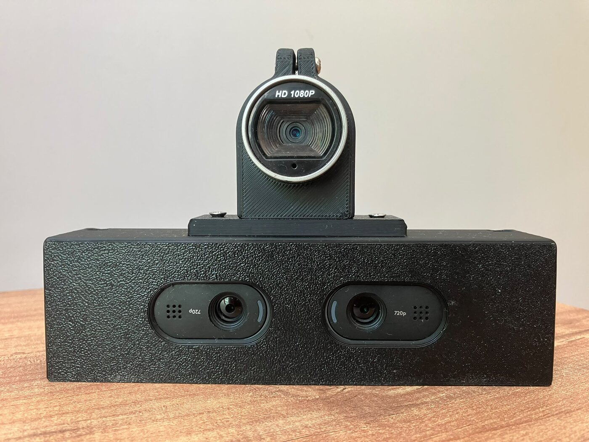</p>

## Proje Hakkında

Bu çalışmada, düşük maliyetli bir stereo kamera sisteminin ölçtüğü 3B konumdaki hatanın makine öğrenmesi yöntemleriyle düzeltilmesi amaçlanmıştır.

Sistemde iki kameradan oluşan stereo düzeneğe ek olarak, referans ölçüm için üçüncü bir kamera kullanılmıştır. Hedef üzerindeki AprilTag'in konumu hem stereo sistem hem de referans kamera tarafından eş zamanlı ölçülmüş, iki ölçüm arasındaki fark eğitim verisi olarak kaydedilmiştir. Toplanan 451 ölçüm üzerinde 10 farklı regresyon yöntemi karşılaştırılmış, en iyi modeller stereo sistemin 3B konum hatasını yaklaşık 7,5 kat azaltmıştır.

## Öne Çıkan Sonuçlar

| | Ham stereo | ML ile düzeltilmiş (Ekstra Ağaçlar) |
|---|---|---|
| 3B konum hatası (ortalama, Öklid) | 3.98 mm | **0.53 mm** |
| X / Y / Z eksen hataları (MAE) | 1.77 / 1.20 / 2.95 mm | **0.20 / 0.05 / 0.47 mm** |
| İyileşme gösteren test noktası oranı | — | %97.8 |
| İstatistiksel anlamlılık (eşleştirilmiş t-testi) | — | p < .001 (tüm eksenlerde) |

Sonuçlar, eğitimde kullanılmayan 91 noktalık test seti üzerinden hesaplanmıştır.

## Sistem Donanımı

<p align="center">
  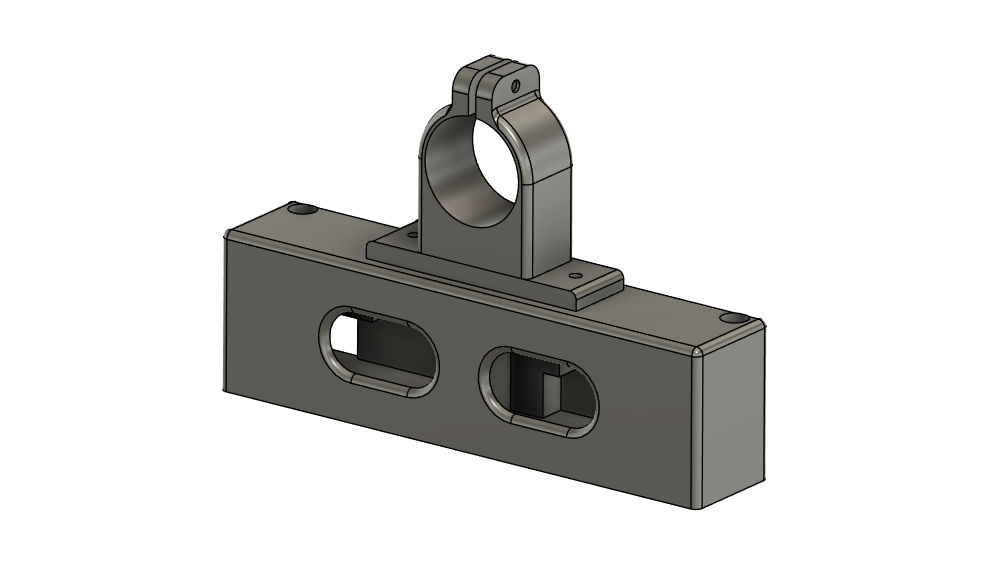
  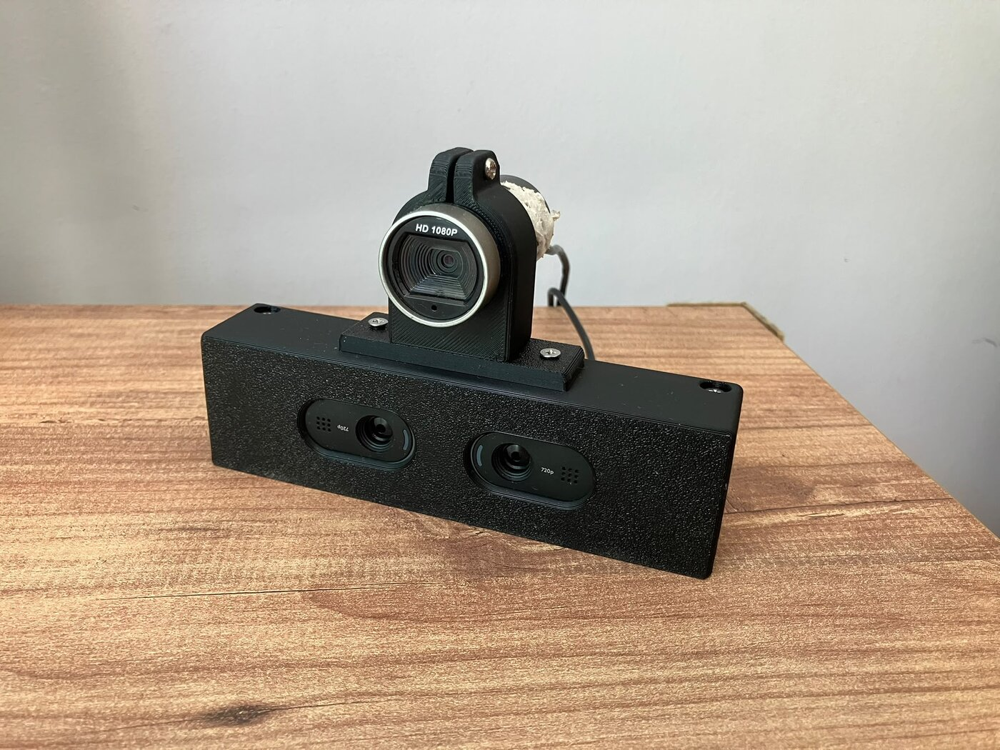
</p>

Stereo kameralar ve referans kamera, CAD ortamında tasarlanıp üretilen ortak bir gövdeye yerleştirilmiştir. Stereo kameralar gövdenin ön yüzünde, referans kamera ise üst kısımdaki kelepçede bulunmaktadır. Görüntüler 640×480 çözünürlükte işlenmektedir.

## İş Akışı

<p align="center">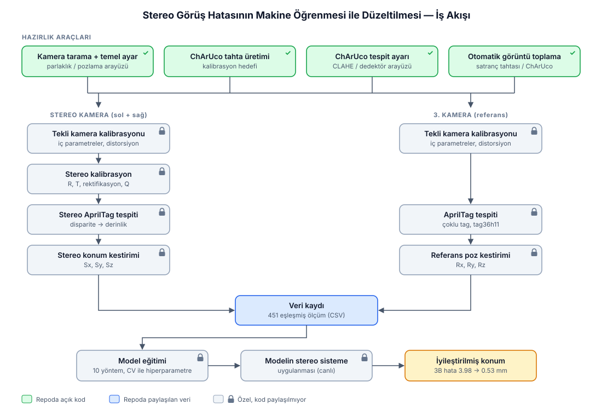</p>

Çalışma; kamera hazırlığı, kalibrasyon, eş zamanlı ölçüm, veri kaydı, model eğitimi ve modelin canlı sisteme uygulanması adımlarından oluşmaktadır. Hazırlık araçlarının kodları bu repoda paylaşılmıştır. Kalibrasyon, konum kestirimi ve makine öğrenmesi katmanlarının kodları özel tutulmakta olup repoya eklenmemiştir. Bu adımlar diyagramda kilit simgesiyle gösterilmiştir.

## Kalibrasyon ve Arayüzler

Kamera ayarları, kalibrasyon hedefinin tespiti ve veri toplama işlemleri için PyQt tabanlı arayüzler geliştirilmiştir.

<p align="center">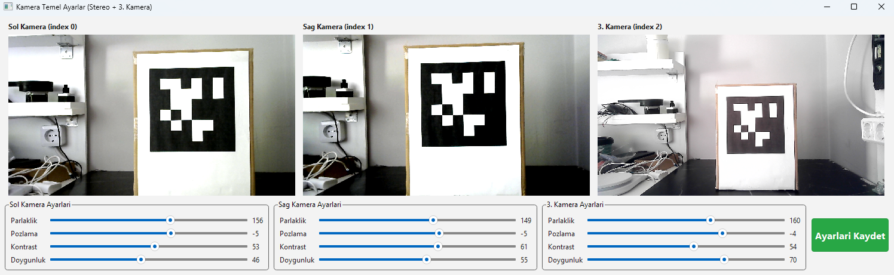</p>
<p align="center"><i>Kamera temel ayarlar arayüzü: kameraların parlaklık, pozlama, kontrast ve doygunluk değerleri canlı görüntü üzerinden ayarlanır. Görseldeki sürümde referans kamera da yer almaktadır; repodaki sürüm stereo kameralar içindir.</i></p>

<p align="center">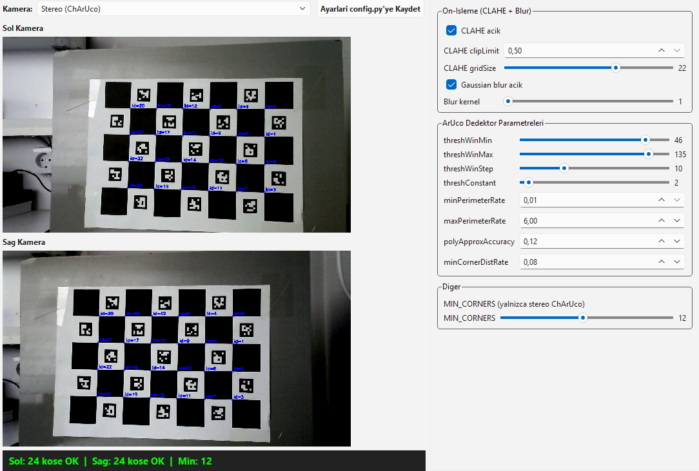</p>
<p align="center"><i>ChArUco tespit ayarları arayüzü: görüntü ön işleme (CLAHE, bulanıklaştırma) ve ArUco dedektör parametreleri canlı olarak ayarlanır, sonuç yapılandırma dosyasına kaydedilir.</i></p>

<p align="center">
  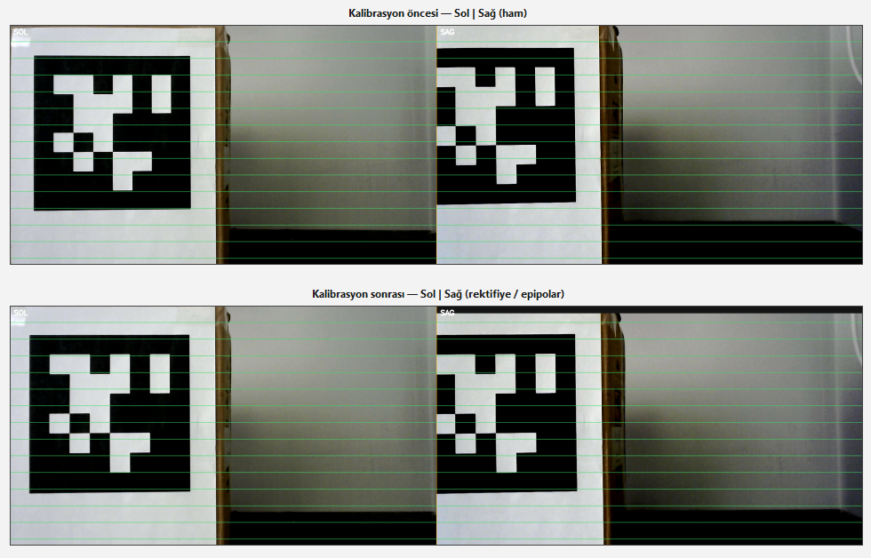
  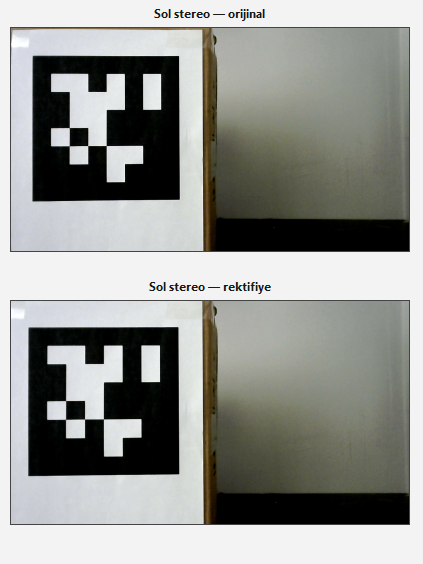
</p>
<p align="center"><i>Stereo kalibrasyon sonrası doğrulama: kalibrasyon öncesi ve sonrası epipolar çizgiler (solda), orijinal ve rektifiye edilmiş görüntü (sağda).</i></p>

### Kalibrasyon görüntülerinin toplanması

Kalibrasyon görüntüleri, ChArUco tahtası farklı konum ve açılarda tutularak otomatik yakalama aracıyla toplanmıştır. Araç, iki kamerada da yeterli sayıda köşe tespit edildiğinde görüntü çiftini kaydetmektedir.

| Yakalama arayüzü | Ortam |
|---|---|
| 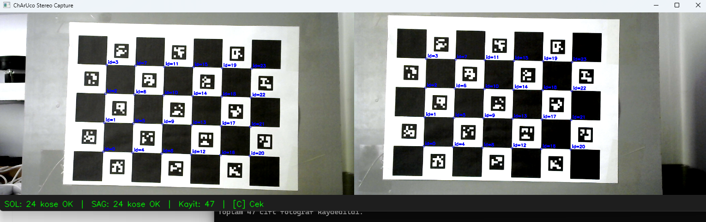 | 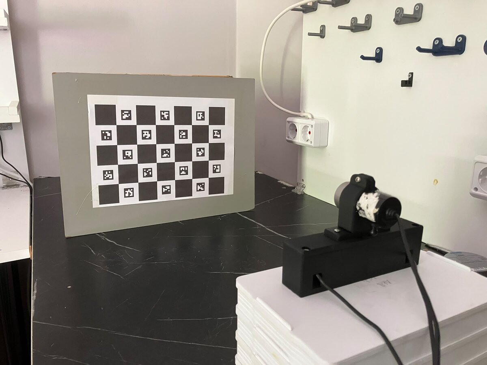 |
| 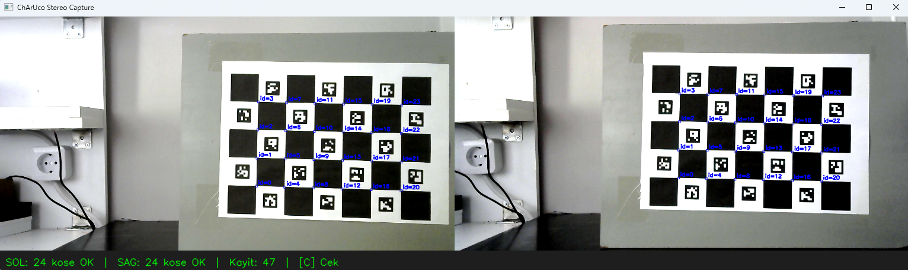 | 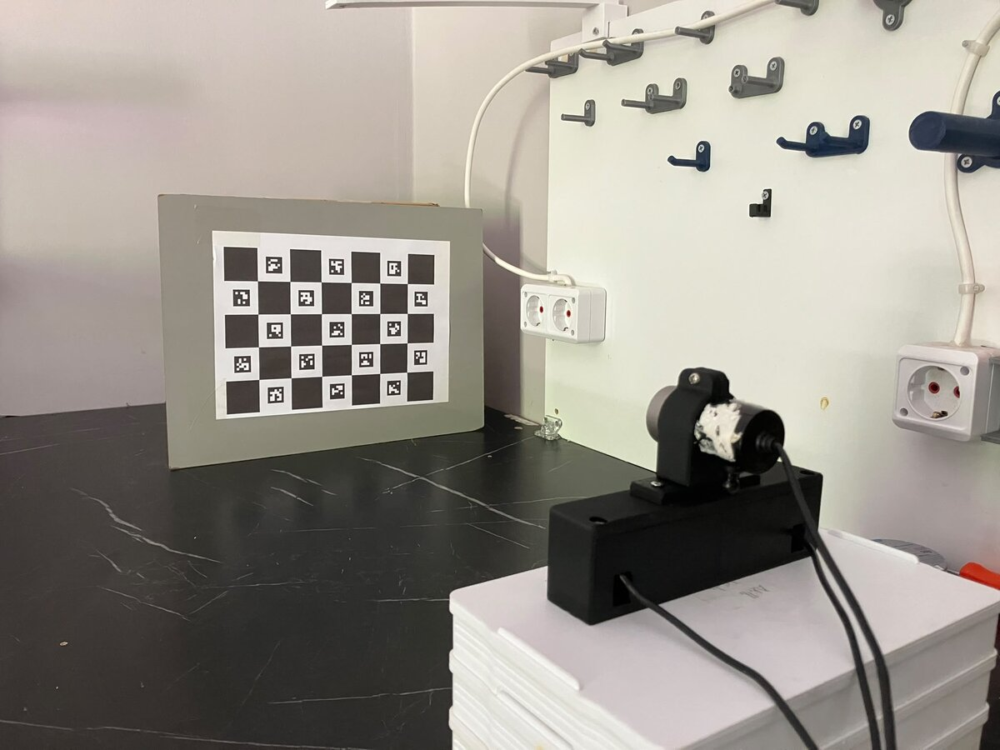 |
| 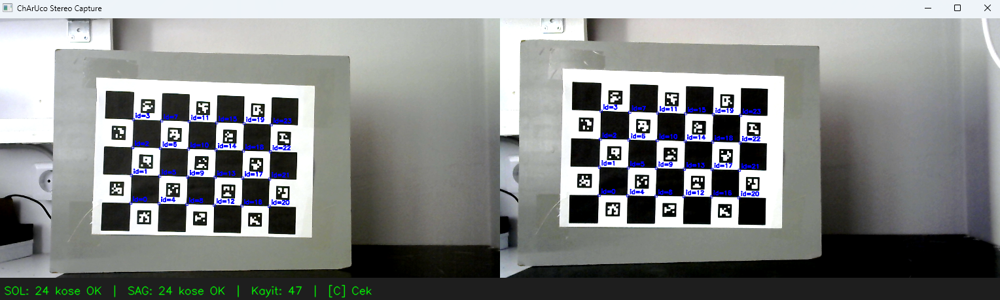 | 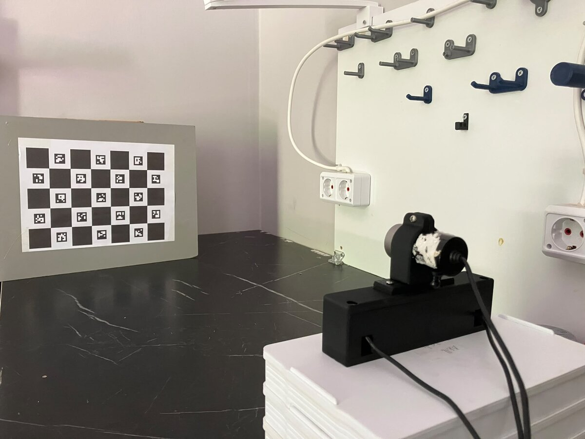 |

### Eş zamanlı ölçüm ve veri toplama

<p align="center">
  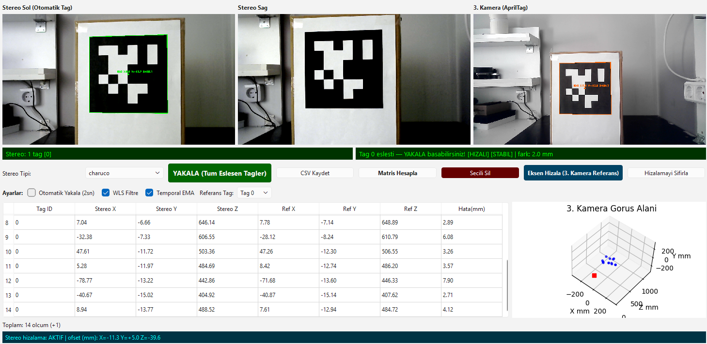
  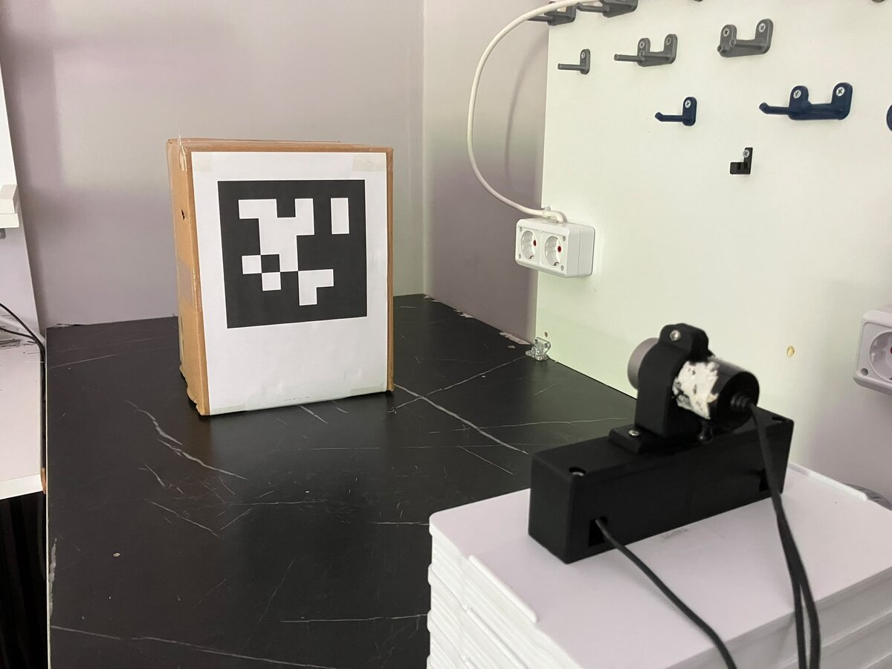
</p>
<p align="center"><i>Veri toplama arayüzü (solda) ve ölçüm ortamı (sağda).</i></p>

Veri toplama arayüzünde stereo görüntüler ve referans kamera görüntüsü birlikte işlenmektedir. Arayüz, AprilTag'in stereo sistemle ve referans kamerayla ölçülen konumlarını, aralarındaki farkı ve referans kameranın görüş alanını 3B olarak göstermektedir.

## Sonuçlar

<p align="center">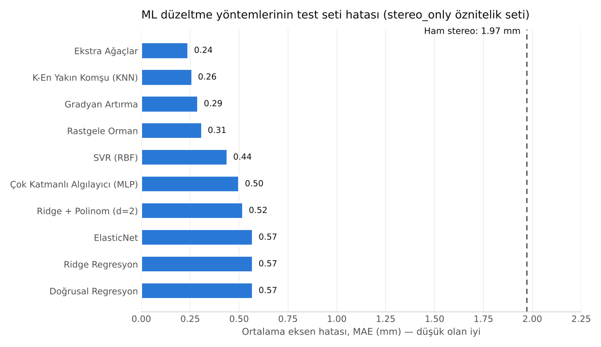</p>

Doğrusal yöntemlerden topluluk (ensemble) ağaç yöntemlerine ve sinir ağlarına kadar 10 regresyon yöntemi aynı veri üzerinde karşılaştırılmıştır. Hiperparametreler yalnızca eğitim verisi üzerinde, 5 katlı çapraz doğrulama ile seçilmiştir. Grafikteki değerler, X, Y ve Z eksen hatalarının ortalamasıdır.

En iyi sonuçları **Ekstra Ağaçlar** ve **K-En Yakın Komşu** yöntemleri vermiştir. Ağaç tabanlı yöntemlerin tamamı doğrusal yöntemlerden belirgin şekilde daha iyi sonuç vermiştir. Bu sonuç, stereo hatasının doğrusal olmayan bir yapıya sahip olduğuna işaret etmektedir.

| Eksen | Ham stereo MAE | Ekstra Ağaçlar MAE | t istatistiği | p değeri |
|---|---|---|---|---|
| X | 1.77 mm | 0.20 mm | 12.26 | < .001 |
| Y | 1.20 mm | 0.05 mm | 12.40 | < .001 |
| Z (derinlik) | 2.95 mm | 0.47 mm | 11.95 | < .001 |
| 3B (Öklid) | 3.98 mm | 0.53 mm | 16.82 | < .001 |

Stereo sistemin en büyük hatası derinlik (Z) ekseninde görülmektedir. Model, tüm eksenlerde hatayı istatistiksel olarak anlamlı biçimde azaltmıştır.

## Repodaki İçerik

```
arayuzler/
├── 01_kamera_tarama.py                 Bağlı kameraların indekslerini bulur
├── 02_kamera_temel_ayarlar_arayuzu.py  Parlaklık / pozlama / kontrast arayüzü → camera_settings.json
├── 03_generate_board.py                ChArUco kalibrasyon tahtası üretir
├── 04_charuco_tespit_ayarlari_arayuzu.py  ChArUco / AprilTag tespit ayarları arayüzü → config.py
├── 11_capture_chessboard_auto.py       Satranç tahtası ile otomatik stereo görüntü yakalama
├── 13_capture_charuco_auto.py          ChArUco ile otomatik stereo görüntü yakalama
├── camera_utils.py, config.py, detect_tuning_io.py   Ortak yardımcı modüller
└── requirements.txt
veri/
└── olcum_verisi.csv                    451 eşleşmiş ölçüm (stereo + referans)
docs/
├── diyagram/                           İş akışı diyagramı
└── gorseller/                          Donanım, arayüz, veri toplama ve sonuç görselleri
```

### Arayüzlerin çalıştırılması

```bash
cd arayuzler
pip install -r requirements.txt
python 01_kamera_tarama.py                 # kamera indekslerini bulun, config.py'ye yazın
python 02_kamera_temel_ayarlar_arayuzu.py  # kamera ayarlarını yapıp kaydedin
python 13_capture_charuco_auto.py          # kalibrasyon görüntülerini toplayın
```

### Ölçüm verisi

`veri/olcum_verisi.csv` dosyasındaki her satır, aynı anda stereo sistem ve referans kamera ile yapılmış bir ölçümdür. Ölçümler kameraya yaklaşık 47–76 cm uzaklıkta, yatayda ±19 cm aralığında alınmıştır.

| Sütun | Açıklama |
|---|---|
| `tag_id` | Ölçülen AprilTag kimliği |
| `sx`, `sy`, `sz` | Stereo sistemin ölçtüğü konum (mm) |
| `rx`, `ry`, `rz` | Referans kameranın ölçtüğü konum (mm) |
| `err` | İki ölçüm arasındaki 3B Öklid mesafesi (mm) |
| `disp_px` | Tag merkezindeki disparite (piksel) |
| `u_norm`, `v_norm` | Tag merkezinin normalize görüntü koordinatları |
| `disp_local_std` | Tag çevresindeki disparitenin standart sapması |

## Lisans

Bu repodaki kodlar ve veri [MIT Lisansı](LICENSE) ile yayımlanmıştır.

---

**Deniz Can Aykurt** · Elektrik Elektronik Mühendisi
